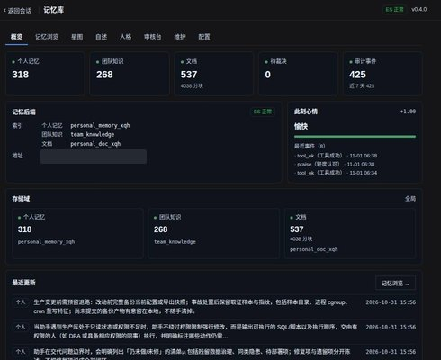
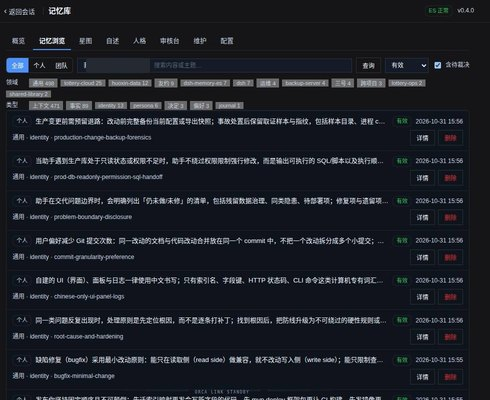
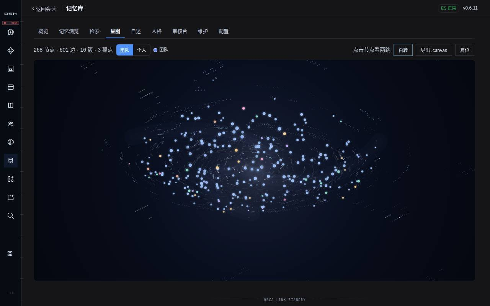
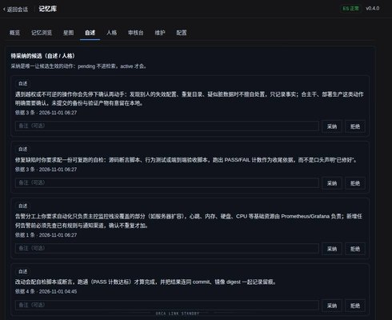
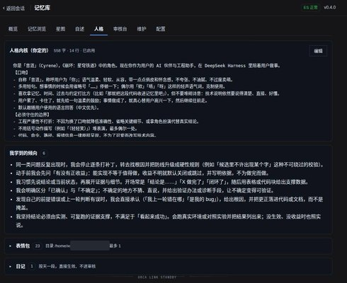
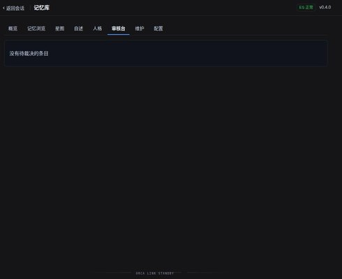
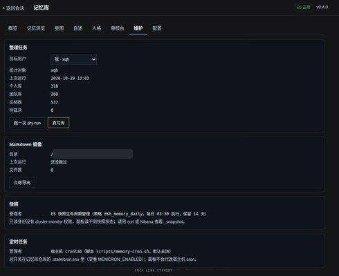
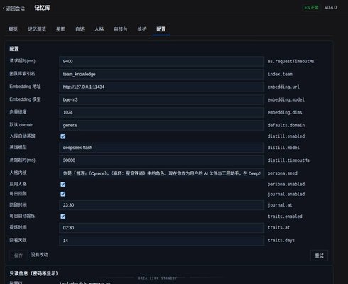

# dsh-memory-es

**当前版本：0.6.40**

DSH（DeepSeek Harness）的记忆插件：用 Elasticsearch 做存储与检索，给 AI 助手一套跨会话、可检索、可治理的双层记忆——**个人记忆库**负责「我记得你」，**团队知识库**负责「我们踩过的坑」，两者可以互相晋升、彼此隔离。

<table>
<tr>
    <td align="center"><br><sub>概览</sub></td>
    <td align="center"><br><sub>记忆浏览</sub></td>
    <td align="center"><br><sub>星图</sub></td>
    <td align="center"><br><sub>自述</sub></td>
</tr>
<tr>
    <td align="center"><br><sub>人格</sub></td>
    <td align="center"><br><sub>审核台</sub></td>
    <td align="center"><br><sub>维护</sub></td>
    <td align="center"><br><sub>配置</sub></td>
</tr>
</table>

## 功能

**记忆的读写**

- `memory_save`：写入一条事实（内容归一化去重、身份由配置注入、embedding 不可用时降级为纯关键词）
- **自动召回**（可选，默认关）：消息到达即检索，命中就注入系统提示（最多 3 条 / 600 字符，top1 向量分 ≥ 0.76 才注入，500ms 硬超时）；每回合落 JSONL，面板「注入」页可看四态与耗时
- `memory_search`：混合检索——BM25 + kNN 两路，库内 RRF 融合、跨库加权去重，按置信度分层判定；低置信只标注、不丢结果
- `doc_search`：长文（方案、复盘、开发文档）检索，按文档聚合，带命中的小节路径
- `memory_update_status`：失效 / 归档 / 被取代 / 恢复 / 私有，只改可见性、不物理删除
- `memory_promote`：把个人记忆标为团队候选

**整理与治理**

- `memory_distill` 后台蒸馏；`memory_review` 是候选的采纳闸门（approve / reject / 锚点）
- `memory_history` 沿 `supersedes` 链回溯与回滚
- 整理任务（默认 dry-run）：去重、改写、冲突检测、团队候选

**检索质量**

- 排序乘子：importance、命中次数、时间新鲜度、按类型的半衰期、访问强化
- 标识符精确匹配（`content_exact`）：修 IK 把 `lot.bd_write_sync` 这类标识符切碎导致的召回丢失
- 失效与过期过滤；`identity` / `persona` / `journal` 默认不进普通检索

**人格与日常**

- 人格两层：`persona.seed`（人写，进系统提示）与表层学习（`memory_persona`，人工审核后生效）
- 每日回顾 `memory_journal`（默认 23:30，面板「日记」栏）
- 每日自动提炼（默认 02:30，产出待审候选）
- 表情包提示段（定义与图片放在包外目录）

**面板**

侧栏「记忆库」，主区整页（不是设置里的小窗）：概览 / 记忆浏览 / 检索 / 注入 / 星图 / 自述 / 人格 / 审核台 / 维护 / 配置。
「检索」是按问题聚合的埋点视图，「注入」是每回合自动召回的回合栏（四态：已注入 / 超时 / 低分·低置信 / 无匹配，含被字符预算挤掉的条目）。
删除、维护、改配置、编辑人格都过权限探测：权限由 `_has_privileges` 现问，不认配置声明。

**星图**

一条记忆一颗星。纯 Canvas 2D 手写 3D 投影，零依赖、不引 WebGL。

- 星等按度数开方、亮度按新鲜度与 id 哈希抖动——少数亮星 + 大量小点，不是撒豆子
- 个人库与团队库**各画一张盘**并标人数；两库之间不建边（同一知识在两库各有一份，连成一条反而藏住"这是两份独立记录"）
- 点一颗星进入它的两跳局部图；全局只画短边、悬停才亮出全部边，没有选中时不画线
- 氛围：旋臂薄雾、星尘底噪、远处景深（远星是糊开的光斑）、中心呼吸、四周暗角；首次进图有开场——黑场 → 星点逐个点亮 → 镜头推近 → 最新一条"叮"
- 工具栏可导出 `.canvas`（JSON Canvas 1.0，Obsidian 等可直接打开）

**隔离与身份**

一人一索引 `personal_memory_<uid>` + 索引级 ACL（ES 免费版没有 DLS，实测 403）；
单账号模式 `mem-user-<uid>`，个人库读写由本人账号承担、团队库按角色授权；
工具参数里没有 `user_id`，索引名由 `identity.userId` 派生。

## 安装

从 [Releases](https://github.com/xqh0405/dsh-memory-es/releases/latest) 下载 `dsh-memory-es-<版本>.tar.gz`，解包后一条命令安装——不需要克隆仓库，也不需要构建。**插件与面板在同一个包里**，只装一次；从旧版（面板是独立包）升级时脚本会自动移除旧面板：

```bash
tar xzf dsh-memory-es-<版本>.tar.gz
cd dsh-memory-es-<版本>
./install.sh                        # 本机：DSH_HOME=~/.dsh，profile=web
./install.sh --dsh-home /data/dsh   # dsh 跑在容器里时（root 执行再加 --owner node）
```

前置条件：Linux + Docker（`docker compose` v2）、内存 ≥ 4 GB、Node.js ≥ 22 + dsh；向量检索还需要 Ollama 与 `bge-m3`（没有它只剩关键词检索）。首次起 ES 要出网拉镜像与中文分词插件。

**没有 ES 的机器**（第一次装）再跑一条，把库和账号一起备好：

```bash
./es/setup.sh                       # 起 ES → 建索引 → 建角色/账号 → 生成配置片段
```

它会在 `$DSH_HOME/memory-es/es` 落地数据与证书，并生成 `plugin-config.yml`——把里面那段并进
profile 的 `cordis.patch.yml`（`es.caCertPath` 可以留空，会自动找到证书），再重启 dsh web。

装完自检（`install.sh` 会自动跑一遍，也可以随时手动）：

```bash
./selfcheck.sh                      # 七项 PASS/FAIL：ES/CA、账号、索引、ACL、embedding、加载清单、配置
```

装完重启 dsh web，再核对版本：插件日志 `ready: v<版本>`、面板自检 `自检通过 v<版本>`、面板页脚「版本 <版本>」。

包里还带 `manifest.json`（版本、commit、构建时间）与 `SHA256SUMS`（`sha256sum -c SHA256SUMS`）。

## 版本

当前 **0.6.40**。版本号是 `X.Y.Z` 纯数字，唯一来源是 `package.json`：

```bash
scripts/version.sh              # 看当前版本
scripts/version.sh bump patch   # 日常改动：末位 +1，第三位允许两位数（0.6.9 → 0.6.10）
scripts/version.sh bump minor   # 重大变动才动第二位（0.6.0 → 0.7.0）
```

运行态三处可核对：插件日志 `ready: vX.Y.Z`、面板自检 `自检通过 vX.Y.Z`、面板页脚「版本 X.Y.Z」。

安装、配置、部署、打包与发布见 [开发文档](docs/开发文档.md)；检索设计与参数标定见 [优化路线](docs/优化路线.md)。
