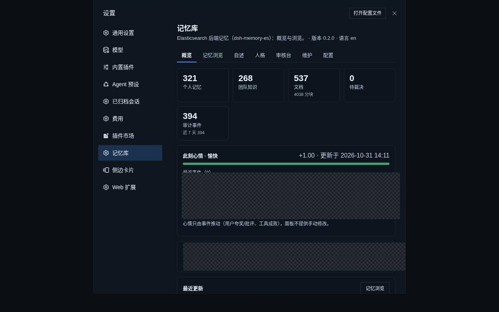
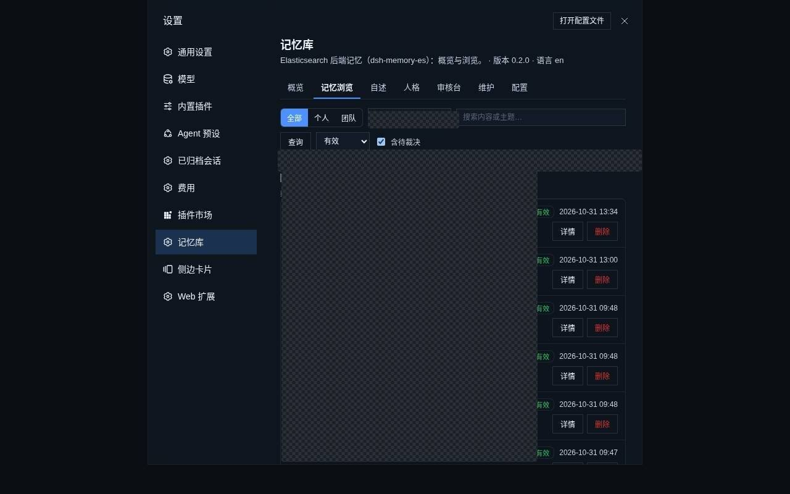

# dsh-memory-es

**当前版本：0.2.0**

DSH（DeepSeek Harness）的记忆插件：用 Elasticsearch 做存储与检索，给 AI 助手一套跨会话、可检索、可治理的双层记忆——**个人记忆库**负责「我记得你」，**团队知识库**负责「我们踩过的坑」，两者可以互相晋升、彼此隔离。





## 功能

**记忆的读写**

- `memory_save`：写入一条事实（内容归一化去重、身份由配置注入、embedding 不可用时降级为纯关键词）
- `memory_search`：混合检索——BM25 + kNN 两路，库内 RRF 融合、跨库加权去重，按置信度分层判定；低置信只标注、不丢结果
- `doc_search`：长文（方案、复盘、开发文档）检索，按文档聚合，带命中的小节路径
- `memory_update_status`：失效 / 归档 / 被取代 / 恢复 / 私有，只改可见性、不物理删除
- `memory_promote`：把个人记忆标为团队候选

**整理与治理**

- `memory_distill` 后台蒸馏；`memory_review` 是候选的采纳闸门（approve / reject / 锚点）
- `memory_history` 沿 `supersedes` 链回溯与回滚
- 整理任务（默认 dry-run）：去重、改写、冲突检测、团队候选

**检索质量**

- 排序乘子：importance、命中次数、时间新鲜度、按类型的半衰期、访问强化
- 标识符精确匹配（`content_exact`）：修 IK 把 `lot.bd_write_sync` 这类标识符切碎导致的召回丢失
- 失效与过期过滤；`identity` / `persona` / `journal` 默认不进普通检索

**人格与日常**

- 人格两层：`persona.seed`（人写，进系统提示）与表层学习（`memory_persona`，人工审核后生效）
- 每日回顾 `memory_journal`（默认 23:30，面板「日记」栏）
- 每日自动提炼（默认 02:30，产出待审候选）
- 表情包提示段（定义与图片放在包外目录）

**面板**

设置 → 记忆库：概览 / 记忆浏览 / 自述 / 人格 / 审核台 / 维护 / 配置。
删除、维护、改配置、编辑人格都过权限探测：权限由 `_has_privileges` 现问，不认配置声明。

**隔离与身份**

一人一索引 `personal_memory_<uid>` + 索引级 ACL（ES 免费版没有 DLS，实测 403）；
单账号模式 `mem-user-<uid>`，个人库读写由本人账号承担、团队库按角色授权；
工具参数里没有 `user_id`，索引名由 `identity.userId` 派生。

## 版本

当前 **0.2.0**。版本号是 `X.Y.Z` 纯数字，唯一来源是 `package.json`：

```bash
scripts/version.sh              # 看当前版本
scripts/version.sh bump patch   # 修 bug：0.2.0 → 0.2.1
scripts/version.sh bump minor   # 新能力：0.2.1 → 0.3.0
```

运行态三处可核对：插件日志 `ready: vX.Y.Z`、面板自检 `自检通过 vX.Y.Z`、面板页脚「版本 X.Y.Z」。

安装、配置、部署、打包与发布见 [开发文档](docs/开发文档.md)；检索设计与参数标定见 [优化路线](docs/优化路线.md)。
